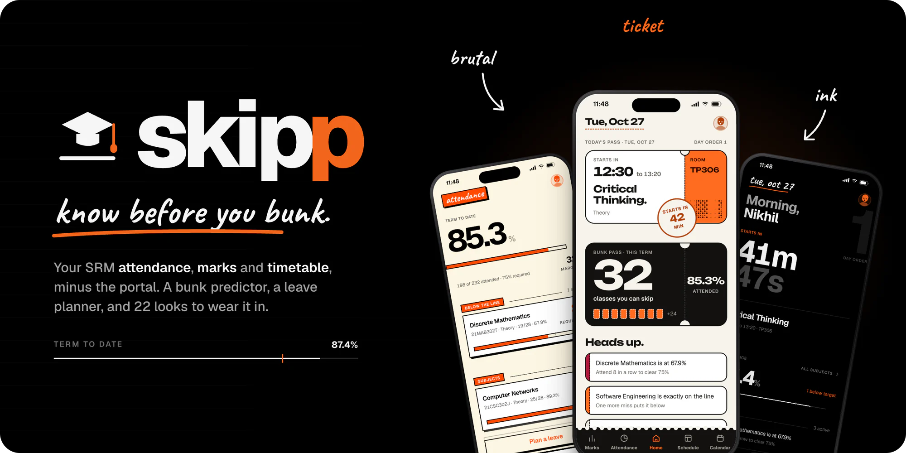
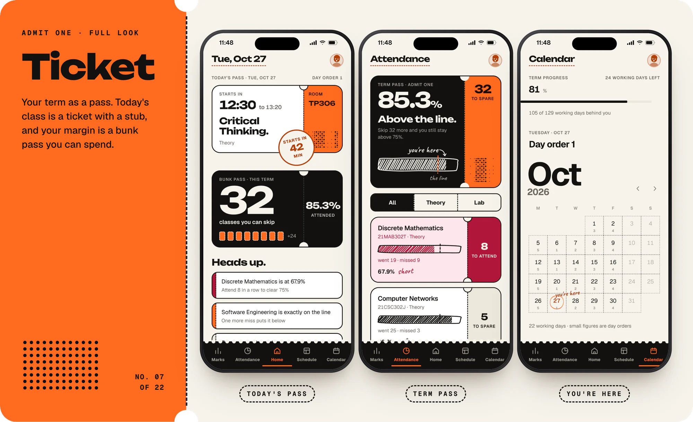
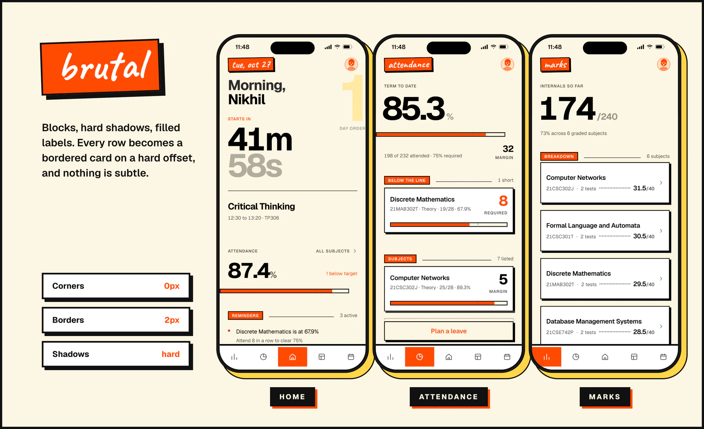
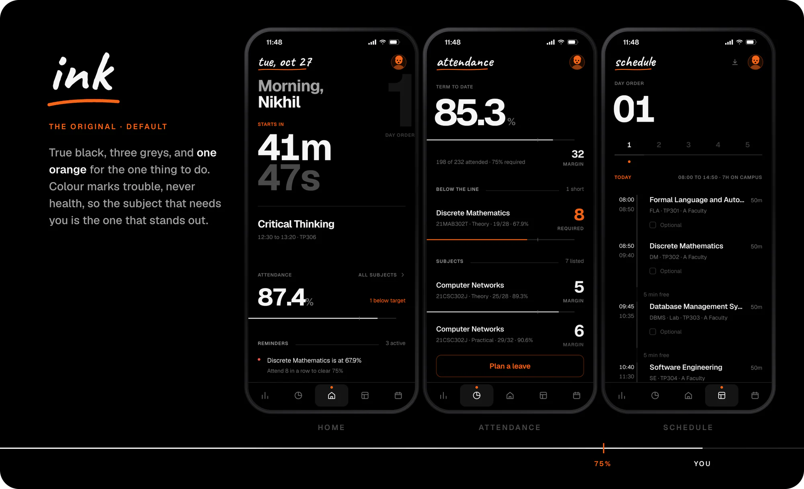
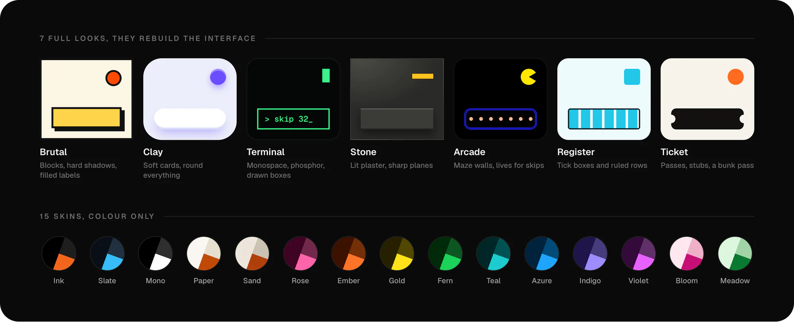
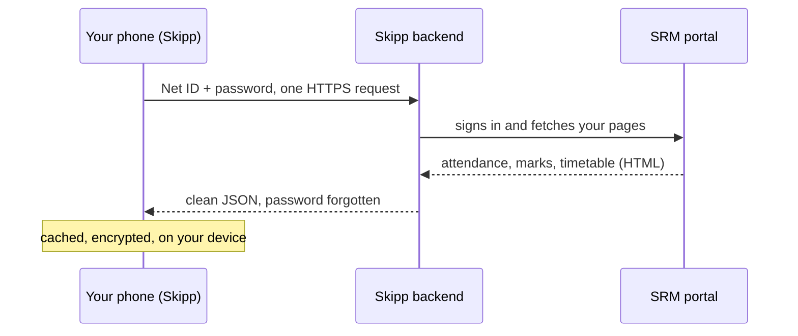

  

  <a href="https://skipp.life"><b>skipp.life</b></a>
  &nbsp;&middot;&nbsp; <a href="#what-it-does">What it does</a>
  &nbsp;&middot;&nbsp; <a href="#pick-a-look">Looks</a>
  &nbsp;&middot;&nbsp; <a href="#how-it-works">How it works</a>
  &nbsp;&middot;&nbsp; <a href="#privacy--security">Privacy</a>

Skipp signs into the SRM portal for you and turns your attendance, marks and timetable into a
fast app that installs to your home screen. It tells you how many classes you can still miss,
shows what a leave will cost before you take it, and works out the grade you're on track for
from your own internals.

Not affiliated with SRM. Your password and your data are never stored on a server, ours or
anyone else's.

---

## What it does

- **Can I bunk?** Every subject tells you how many more classes you can skip and stay above
  75%, or how many you need to attend in a row to climb back.
- **Leave planner.** Pick a day or a range, mark it as leave or OD/ML, and see the hit subject
  by subject before you take it: new margins, the earliest date you'd be back above 75%, and a
  warning if anything would drop below the line.
- **Marks and a grade forecast.** Internals component by component, the grade each subject is
  on track for, and what the final exam needs to hold it.
- **Timetable by day order**, the way SRM actually runs a term. Add classes the portal doesn't
  list, mark a course optional so it stops counting, and save the whole week as a picture.
- **Calendar** with day orders and holidays from the portal's own planner, including how long
  each break really is (yes, it spots the long weekends).
- **Installs like an app** on iOS and Android, full screen, no browser bar. A nudge 30 and 5
  minutes before class, and a note when the portal marks your attendance.
- **A real desktop layout** past 1024px, with a sidebar, not a phone screen stretched wide.
- **22 looks** to wear it in. See below.

---

## Pick a look

Themes in Skipp aren't recolours. Seven **full looks** change how the app is built (shapes,
borders, type, sometimes the whole layout of a screen) and fifteen **skins** recolour the
default. Here are three of them.

### Ticket

Your term as a pass. Today's class is a ticket with a stub, your margin is a bunk pass you can
spend, and today is circled in pen on the calendar. Ticket is one of two looks (with Register)
that recompose Home and Attendance instead of just restyling them.

### Brutal

Cream, black rules and hard offset shadows. Every row becomes a bordered block, every label a
filled slab, and nothing is subtle.

### Ink

The default. True black, three greys, and one orange saved for the one thing to do. Colour
marks trouble, never health: a screen full of safe subjects stays quiet, so the one that needs
you is impossible to miss.

### And the other nineteen

Screenshots use sample data, not a real student's.

---

## How it works

The portal has no API and blocks cross-origin requests, so the sign-in and the scrape have to
run on a server. The Python backend does exactly that and nothing else: it signs in, parses
the portal's pages into JSON, and forgets your password the moment the request ends. React
owns all of the UI. Most students sign in through SRM academia; first years can use the
Student Portal instead.

One sign-in covers the whole session. Attendance, marks and the timetable come back together
and are cached, encrypted, on your device, so reopening the app or switching tabs never signs
in again. SRM's portal throws a CAPTCHA after rapid logins and enforces a hard daily sign-in
cap per account, and Skipp is built to stay well under both.

---

## Privacy & security

Skipp handles other students' SRM passwords, so this section is not boilerplate.

- **Nothing is stored on a server.** The backend holds a password in memory for one request
  and never writes it, or anything scraped with it, to a database or a log.
- **Credentials are encrypted on your device** with a non-exportable AES-GCM key
  (`extractable: false`): the key can never be read back out, not even by Skipp. Clearing your
  browser data wipes it, a hard kill switch.
- **All traffic is HTTPS.**
- **There is no push server, on purpose.** Waking a closed phone would mean keeping a database
  of who has class when, and announcing attendance the instant it changes would mean a server
  holding everyone's password and signing in dozens of times a day per student, against the
  portal's own daily cap. That doesn't trade privacy for a feature, it locks students out of
  their own portal. So notifications are raised by the app itself, when you open it.
- Only ever use it with your own credentials.

---

## Tech stack

| Layer | Tech |
| --- | --- |
| Frontend | Next.js 16 (App Router), React 19, TypeScript |
| Styling | Tailwind CSS v4, tokens in `globals.css`, one block per theme |
| Motion | GSAP, one motion layer (`lib/motion.ts`), reduced motion handled in one place |
| PWA | Hand-written `public/sw.js` (network first) and local notifications |
| Backend | Python, FastAPI |
| Scraping | httpx, BeautifulSoup4 |
| On-device crypto | Web Crypto API (AES-GCM), IndexedDB |
| Analytics | Vercel Web Analytics and Speed Insights (cookieless, no personal data) |

---

## Legal

Not affiliated with, endorsed by, or connected to SRM Institute of Science and Technology.
Skipp only ever reads a student's own data with their own credentials, stores nothing
server-side, and goes easy on the portal: it caches aggressively and rate-limits itself.

---

  Crafted by <a href="https://www.linkedin.com/in/nikhilb21/">Nikhil Balamurugan</a>.

